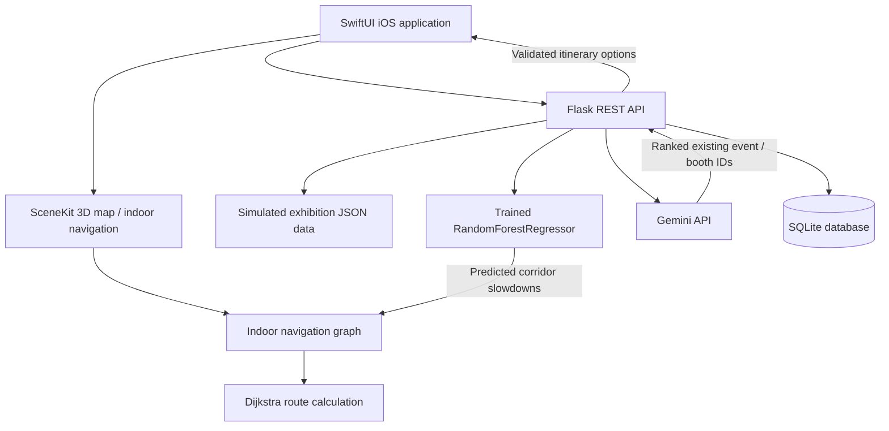

# Expo 2030 Riyadh Navigator

**An AI-assisted iOS visitor navigation and planning prototype for Expo 2030 Riyadh.**

Built with SwiftUI and Python, the application combines interactive 3D maps, indoor navigation, personalized visit planning, and machine-learning-based crowd simulation in an Arabic-first experience.

> **Prototype notice:** This is an independent hackathon prototype, not an official Expo 2030 application. Exhibition locations, event schedules, booth information, indoor layouts, crowd conditions, and visitor-flow data are **simulated/illustrative**. The crowd model was trained on **synthetically generated data**, not on measurements from Expo 2030. No real-time crowd sensors or official venue data are connected.

## Features

- **Interactive 3D outdoor map:** Explore the exhibition, select pavilions, and view three simulated main entrance gates using SceneKit.
- **Saudi Pavilion indoor navigation:** Explore two modelled floors, browse booths and events, and navigate between destinations on defined walkable corridors.
- **Graph-based route calculation:** Compute indoor walking routes using a weighted graph and Dijkstra's shortest-path algorithm, including floor transitions and estimated walking distances/times.
- **Simulated crowd prediction:** Display light, moderate, or high congestion estimates for indoor corridors using a trained `RandomForestRegressor` model.
- **Crowd-aware routing:** Adjust route travel-time costs using predicted corridor slowdowns and calculate routes that account for simulated congestion.
- **Time-aware forecasts:** Use the current device day and hour for crowd predictions, with an optional selection to explore other simulated time scenarios.
- **Personalized AI visit plans:** Collect visitor interests, priorities, preferences, and available visit time; use Gemini to rank suitable events and booths from the application's existing dataset.
- **Itinerary re-planning:** Preview adjustments when plans change (such as a delay, break, or additional stop), confirm the update, and undo eligible changes.
- **Visitor accounts and journey management:** Support sign-in, saved plans, preferences, notes, and journey records using a local SQLite backend.
- **Discovery and assistant interfaces:** Browse experiences and access a contextual in-app assistant. Some supporting experiences use mock/demo services rather than live external integrations.

## Technologies Used

| Component | Technologies |
| --- | --- |
| iOS application | Swift, SwiftUI, Xcode |
| 3D visualization | SceneKit |
| Backend API | Python, Flask, REST, JSON |
| AI-powered planning | Google Gemini API (`google-genai`) |
| Crowd prediction | scikit-learn `RandomForestRegressor`, pandas, NumPy, joblib |
| Route calculation | Weighted navigation graph, Dijkstra's algorithm (Swift) |
| Data and persistence | Synthetic JSON/CSV datasets, SQLite |
| Environment configuration | `python-dotenv` |

## How It Works



1. **Load exhibition data:** The iOS app requests pavilion, booth, event, and map information from the Flask backend. Bundled map JSON can be used as a fallback for supported map views.
2. **Predict simulated congestion:** The app sends the current day/hour and indoor corridor geometry to the backend. The pre-trained Random Forest model returns an estimated walking-time multiplier for each corridor.
3. **Calculate the route:** Swift applies the predicted multipliers to the indoor navigation graph and uses Dijkstra's algorithm to compute a route along walkable connections, rather than drawing a straight line through the map.
4. **Generate a personalized itinerary:** Visitors choose interests, priorities, and available time. The backend provides dataset-defined event/booth candidates to Gemini, validates the selected IDs and schedule constraints, and returns itinerary suggestions.
5. **Save and adjust plans:** Confirmed plans and visitor information can be stored in SQLite. Re-planning generates a preview before any accepted change is saved.

**Offline/backend limitation:** Bundled map data can support map demonstrations when the API is unavailable, but Gemini itinerary generation and server-side crowd predictions require a running backend. Some screens also use local mock services.

## Data and Model Training

All Expo-specific records used in this prototype are **fictional or simulated**, including pavilion positions, event schedules, booth assignments, indoor geometry, corridor widths, and estimated visitor movement.

- **Exhibition dataset:** The bundled prototype contains 12 simulated pavilions, 32 booths, and 96 events. These are **not official Expo 2030 counts or schedules**.
- **Training dataset:** `backend/data/expo_specific_training_20000.csv` contains **20,000 synthetically generated samples** based on fictional event activity, corridor geometry, visitor-flow assumptions, and time variables.
- **Model:** A scikit-learn **`RandomForestRegressor`** predicts a simulated per-corridor walking-time slowdown multiplier.
- **Inputs:** Hour, minute, day, floor, zone, corridor length and width, estimated flow, event pressure, and assumed comfortable capacity.
- **Training and evaluation:** 16,000 synthetic samples were used for training and 4,000 for testing, split by simulation scenario. The included model is stored at `backend/models/expo_simulated_crowd_rf.joblib`.
- **Output:** Predicted slowdown multipliers are incorporated into the iOS route calculation and mapped into congestion labels for the user interface.

> **Important:** The model's performance measures agreement with held-out **simulated scenarios**, not real-world Expo crowd-prediction accuracy. Travel times and congestion levels should be treated as prototype estimates, not verified operational forecasts.

## Requirements and Setup

### Requirements

- macOS with **Xcode 16 or later**
- An **iOS 17+ simulator** or compatible iPhone
- **Python 3.11+** and `pip`
- Internet access and a valid **Gemini API key** for AI itinerary generation only
- A locally running Flask backend for database-backed features and crowd predictions

### 1. Run the Python backend

Open Terminal in the project's root directory:

```bash
cd backend
python3 -m venv .venv
source .venv/bin/activate
python3 -m pip install -r requirements.txt
cp .env.example .env
```

Edit `backend/.env`. If you want to generate AI itineraries, set a valid `GEMINI_API_KEY` and select a `GEMINI_MODEL` supported by your account. **Never commit the `.env` file or put the API key in the iOS app.** The map and included crowd model do not require a Gemini key.

Start Flask:

```bash
python3 -m app.main
```

The default local backend URL is **`http://127.0.0.1:8001`**. Check it with:

```bash
curl http://127.0.0.1:8001/health
```

### 2. Run the iOS application

1. Open `Expo2030.xcodeproj` in Xcode.
2. Select the `Expo2030` scheme and an iPhone simulator.
3. Verify the development API settings in `Config/Info.plist`:

   ```text
   EXPO_API_MODE     = live
   API_BASE_URL      = http://127.0.0.1:8001
   EXPO_API_BASE_URL = http://127.0.0.1:8001
   ```

4. Press **Command + R** to build and run the app.
5. Explore the outdoor map, enter the Saudi Pavilion, check the simulated crowd estimates, or create a personalized visit plan.

For a physical iPhone, replace `127.0.0.1` with a backend URL reachable from the device. The included HTTP settings are for local development, not production hosting.

**The crowd model is already trained and included in the repository; retraining is not required to run the application.** To regenerate the simulated training data and model, run this optional command from `backend/`:

```bash
python3 scripts/train_expo_sim.py
```

## Project File Hierarchy

```text
Expo2030-Riyadh/
├── Expo2030.xcodeproj/                 # Xcode project
├── Config/
│   └── Info.plist                      # iOS app and backend URL configuration
├── Expo2030/
│   ├── App/                            # Entry point, app state, navigation tabs
│   ├── Features/
│   │   ├── Map/
│   │   │   └── ExpoMapV2/             # 3D map, indoor map, graph routing, API client
│   │   ├── Discover/                  # Pavilion and event discovery
│   │   ├── Personalization/           # Visitor interests and preferences
│   │   ├── Plan/                      # Itinerary and re-planning screens
│   │   ├── Journey/                   # Visitor journey and notes
│   │   ├── Auth/                      # Registration and sign-in
│   │   ├── Account/                   # User account and settings
│   │   └── Assistant/                 # Contextual assistant interface
│   ├── Services/                      # Live and mock data/service implementations
│   ├── Models/                        # iOS data models
│   ├── Components/                    # Reusable UI components
│   ├── DesignSystem/                  # Colors, fonts, and styling
│   └── Resources/
│       └── ExpoMapData/               # Bundled fallback map data (JSON)
├── backend/
│   ├── app/                            # Flask endpoints, planning, inference, storage
│   ├── data/                           # Synthetic exhibition and training data
│   ├── models/                         # Trained Random Forest and evaluation records
│   ├── scripts/                        # Model training and evaluation utilities
│   ├── tests/                          # Python backend tests
│   ├── requirements.txt               # Python dependencies
│   └── .env.example                   # Configuration template (no secrets)
├── .github/workflows/                  # Backend CI test workflow
├── .gitignore                          # Excluded secrets and generated files
└── README.md                           # Project documentation
```
